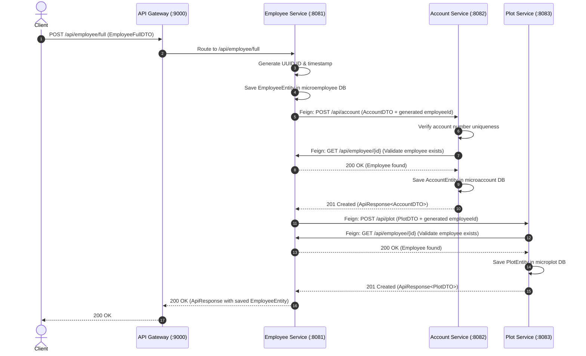
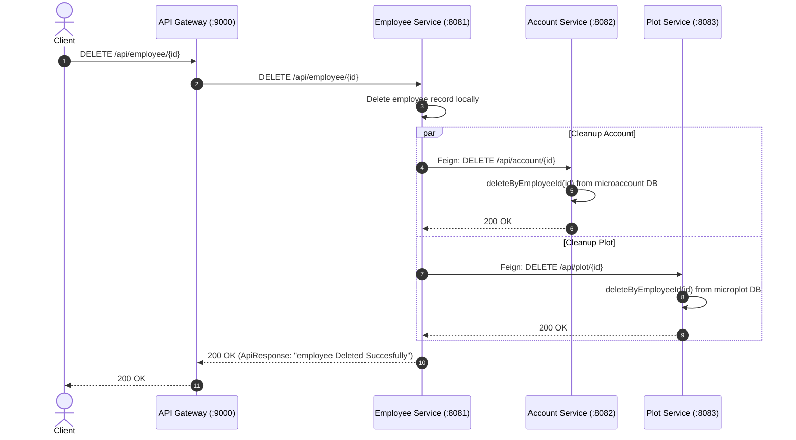

# Employee Plot Management Microservice System

A distributed, microservice-based enterprise system designed to manage Employee records, their associated Bank Accounts, and Plot allocations. Built with **Spring Boot 3.4**, **Spring Cloud 2024 (Eureka, OpenFeign, Gateway MVC)**, and **MySQL**.

---

## Architecture Overview

The system is organized into decoupled microservices communicating synchronously via **Spring Cloud OpenFeign** and exposed through a single entry point managed by **Spring Cloud Gateway**. Service discovery and health monitoring are orchestrated centrally through **Netflix Eureka Server**.

```mermaid
graph TD
    Client["Client / Postman / Frontend"] -->|HTTP:9000| Gateway["API Gateway (micro-apiGateway:9000)"]
    
    subgraph Service Discovery
        Eureka["Eureka Server (eureka-server:8761)"]
    end

    Gateway -.->|Discovery Lookup| Eureka
    EmpService -.->|Registers| Eureka
    AccService -.->|Registers| Eureka
    PlotService -.->|Registers| Eureka

    Gateway -->|/api/employee/**| EmpService["Employee Service (MICRO-EMPLOYEE:8081)"]
    Gateway -->|/api/account/**| AccService["Account Service (MICRO-ACCOUNT:8082)"]
    Gateway -->|/api/plot/**| PlotService["Plot Service (MICRO-PLOT:8083)"]

    EmpService -->|Feign: /api/account| AccService
    EmpService -->|Feign: /api/plot| PlotService
    AccService -.->|Feign: Check Employee /api/employee/{id}| EmpService
    PlotService -.->|Feign: Check Employee /api/employee/{id}| EmpService

    EmpService --- DB1[(MySQL: microemployee)]
    AccService --- DB2[(MySQL: microaccount)]
    PlotService --- DB3[(MySQL: microplot)]
```

---


## Microservices Inventory & Roles

| Service | Port | Eureka Service ID | Role & Responsibilities | Database |
| :--- | :---: | :--- | :--- | :--- |
| **`eureka-server`** | `8761` | `springEurekaServer` | Service Registry: Registers active service instances and handles discovery. | None |
| **`micro-apiGateway`** | `9000` | `micro-apiGateway` | API Gateway: Reverse proxy, route predicates, and client-side load balancing (`lb://`). | None |
| **`micro-employee`** | `8081` | `MICRO-EMPLOYEE` | Core Domain & Orchestrator: Manages employee profiles and coordinates composite operations. | `microemployee` |
| **`micro-account`** | `8082` | `MICRO-ACCOUNT` | Account Domain: Bank account CRUD with duplicate validation and employee verification. | `microaccount` |
| **`micro-plot`** | `8083` | `MICRO-PLOT` | Plot Domain: Real estate/plot allocation CRUD with employee verification and pincode format checks. | `microplot` |

---

## Detailed System Workflows

### 1. Service Discovery & Routing Workflow
1. **Startup**: When each service boots, it registers its application name, host, and port with `eureka-server` (`http://localhost:8761/eureka/`).
2. **Registry Fetch**: `micro-apiGateway` continuously syncs with the Eureka registry.
3. **Dynamic Routing**: Incoming requests at `http://localhost:9000/api/...` are evaluated by path predicates and routed with load balancing:
   - `/api/employee/**` $\rightarrow$ `lb://MICRO-EMPLOYEE`
   - `/api/account/**` $\rightarrow$ `lb://MICRO-ACCOUNT`
   - `/api/plot/**` $\rightarrow$ `lb://MICRO-PLOT`

---

### 2. Composite Full Employee Onboarding Workflow (`POST /api/employee/full`)
Orchestrated by `micro-employee` to create an employee record, bank account, and plot assignment in a single coordinated operation:



---

### 3. Cascading Deletion Workflow (`DELETE /api/employee/{id}`)
Ensures data consistency across services when an employee is removed:



---

### 4. Standalone CRUD & Cross-Service Validation
Both `micro-account` and `micro-plot` can receive direct standalone requests while enforcing referential integrity back to `micro-employee`:
- **Account Creation (`POST /api/account`)**:
  - Checks duplicate account numbers via `accRepo.findByAccNo(accNo)`.
  - Makes a Feign call `employeeClient.getSingleEmployee(employeeId)` to guarantee the employee exists before saving.
- **Plot Creation (`POST /api/plot`)**:
  - Makes a Feign call `empClient.getSingleEmployee(employeeId)`.
  - Validates constraints (e.g., 6-digit regex for `pincode`).
  - Saves the plot record mapped to the `employeeId`.

---

## API Endpoints Reference

All requests can be sent through the API Gateway at `http://localhost:9000`:

| Microservice | Method | Endpoint Path | Description |
| :--- | :---: | :--- | :--- |
| **Employee** | `POST` | `/api/employee` | Create standalone employee record. |
| **Employee** | `POST` | `/api/employee/full` | Composite creation: employee, bank account, and plot. |
| **Employee** | `GET` | `/api/employee` | Retrieve list of all employees. |
| **Employee** | `GET` | `/api/employee/{id}` | Retrieve employee by ID. |
| **Employee** | `DELETE` | `/api/employee/{id}` | Delete employee and cascade delete accounts and plots. |
| **Account** | `POST` | `/api/account` | Create bank account (validates `employeeId` and unique `accNo`). |
| **Account** | `GET` | `/api/account` | Retrieve list of all bank accounts. |
| **Account** | `GET` | `/api/account/{id}` | Retrieve single bank account by account ID. |
| **Account** | `DELETE` | `/api/account/{id}` | Delete account(s) by associated `employeeId`. |
| **Plot** | `POST` | `/api/plot` | Create plot allocation (validates `employeeId` and pincode). |
| **Plot** | `GET` | `/api/plot` | Retrieve list of all plots. |
| **Plot** | `GET` | `/api/plot/{id}` | Retrieve single plot by plot ID. |
| **Plot** | `DELETE` | `/api/plot/{id}` | Delete plot(s) by associated `employeeId`. |

---

## Response & Error Handling Design

### Standard Response Envelope (`ApiResponse<T>`)
Every endpoint returns a unified response payload structure:
```json
{
  "status": "SUCCESS | ERROR | DUPLICATE INPUT",
  "message": "Descriptive status or error message",
  "data": { ... }
}
```

### Global Exception Handling
- **Validation Errors (`MethodArgumentNotValidException`)**: Intercepted and mapped into field-by-field validation failure messages (HTTP 400).
- **Resource Not Found (`ResourceNotFoundException`)**: Returns formatted error with HTTP 404.
- **Duplicate Resource (`DuplicateResourceException`)**: Prevents conflicting bank account numbers (HTTP 400).
- **Feign Inter-Service Failures (`FeignException`)**: Intercepted in both `micro-account` and `micro-plot`, parsing target URLs to extract the referenced `employeeId` and translating raw HTTP errors into readable client responses (e.g., `"Employee not found with id {id}"`).

---

## Setup and Execution

### Prerequisites
- **Java**: JDK 17+
- **Build Tool**: Maven 3.8+ (or bundled `mvnw`)
- **Database**: MySQL Server running on port `3306` with databases:
  - `microemployee`
  - `microaccount`
  - `microplot`

### Startup Order
To ensure proper service registration and routing, start the applications in the following order:

1. **`eureka-server`**: Wait until the Eureka dashboard is available at `http://localhost:8761`.
2. **Domain Microservices**: Start in any order:
   - `micro-account` (port `8082`)
   - `micro-plot` (port `8083`)
   - `micro-employee` (port `8081`)
3. **`micro-apiGateway`**: Start on port `9000` after the domain services are registered in Eureka.

### Containerization
Each service includes Maven plugins (`jib-maven-plugin` and Dockerfile support) for container builds:
```bash
./mvnw clean compile jib:dockerBuild
```
